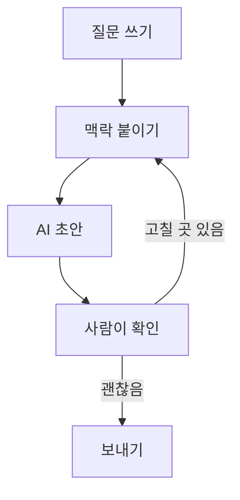

# Media brief: M1 · diagram

lesson: demo · segment: S2 · type: diagram · status: drafted · owner: tool

## Purpose

The learner sees the five stages a request passes through before the answer comes back.

## Spec by type

### diagram
- shows: a request moving through five stages, top to bottom; the check stage is the one to notice
- labels: 질문 쓰기, 맥락 붙이기, AI 초안, 사람이 확인, 보내기
- reading order: top to bottom
- source: `tools/diagram/render.py media/M1.md --out media/M1.png`

## Alt text

질문 쓰기, 맥락 붙이기, AI 초안, 사람이 확인, 보내기의 다섯 단계 흐름도. 확인 단계에서 고칠 곳이 있으면 맥락 붙이기로 돌아갑니다.
