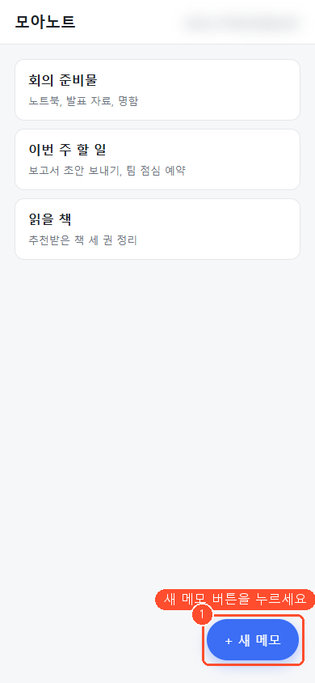
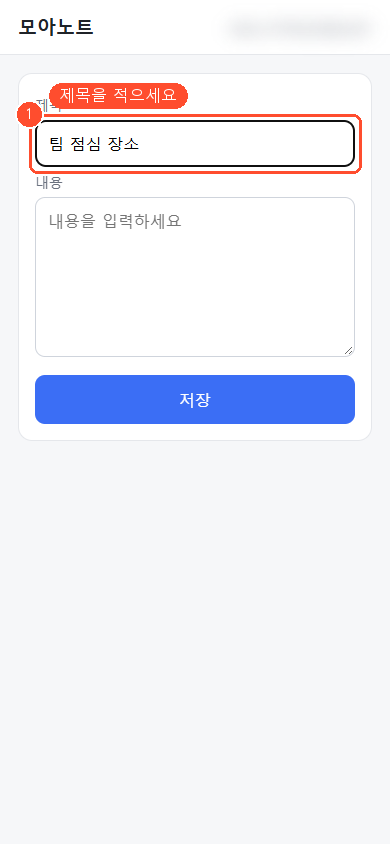
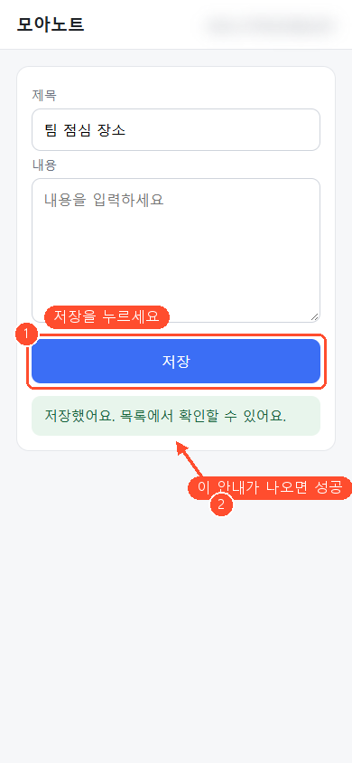

<!-- _class: title -->

# 모아노트에 첫 메모 남기기

3단계 · 약 3분

---

<!-- _class: step -->

1 / 3

## 오른쪽 아래의 [+ 새 메모] 버튼을 눌러 주세요.

✓ 제목과 내용을 쓰는 화면이 열립니다.

---

<!-- _class: step -->

2 / 3

## 제목 칸을 누르고 메모 제목을 적어 주세요.

✓ 적은 제목이 제목 칸에 보입니다.

---

<!-- _class: step -->

3 / 3

## [저장] 버튼을 눌러 주세요.

✓ 초록색으로 &quot;저장했어요&quot; 안내가 나옵니다.

